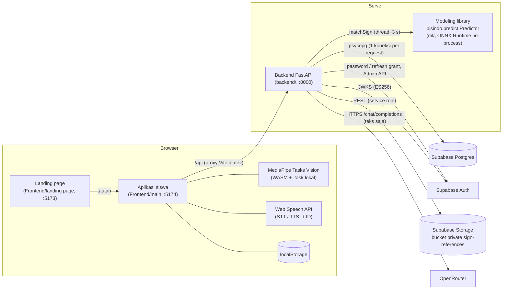

# Architecture: ISYARA

Dokumen ini menjelaskan *struktur dan runtime*: komponen, stack, layout repo, rute FE, penyimpanan klien, variabel lingkungan, cara menjalankan, masalah operasional, dan deployment. Kebutuhan produk ada di [PRD.md](PRD.md); kontrak API, skema data, prompt, dan alur ada di [SYSTEM_DESIGN.md](SYSTEM_DESIGN.md).

---

## 1. Gambaran Tingkat Tinggi



Prinsip runtime:
- Modeling berjalan di proses Backend sebagai library, bukan service HTTP. Predictor dimuat sekali saat startup (~30 detik saat dev, termasuk import).
- Semua dependensi eksternal dibuat di `lifespan` (`backend/app/main.py`). Bila salah satu gagal, app tetap jalan dan endpoint terkait menjawab 503 (`MODELING_UNAVAILABLE`, `AUTH_UNAVAILABLE`, `STORAGE_ERROR`); chat jatuh ke `OfflineChatModel`.
- FE tidak pernah memanggil OpenRouter, Supabase, atau Modeling langsung.

## 2. Tech Stack (versi terkunci)

**Backend** (`backend/pyproject.toml`, CPython `==3.12.*`)

| Paket | Versi | Peran |
|---|---|---|
| fastapi | 0.141.1 | Framework API |
| starlette | 1.7.0 | ASGI |
| uvicorn | 0.54.0 | Server |
| pydantic | 2.11.9 | Validasi (sama dengan ml) |
| psycopg[binary] | 3.3.6 | Postgres langsung, tanpa ORM |
| PyJWT[crypto] | 2.15.1 | Verifikasi JWT ES256 + JWKS |
| cryptography | 50.0.1 | Backend EC untuk PyJWT |
| httpx | 0.28.1 | Supabase Auth/Storage, OpenRouter, TestClient |
| python-multipart | 0.0.32 | Upload multipart |
| pypdf | 6.20.1 | Ekstraksi teks PDF (ADR-053) |
| pytest (extra `test`) | 8.4.2 | Test |

**Modeling** (`ml/requirements.txt`, Python ≥ 3.11; runtime Backend hanya butuh sebagian)

| Paket | Versi | Dipakai runtime Backend |
|---|---|---|
| numpy | 2.2.6 | ya |
| onnxruntime | 1.23.2 | ya |
| scikit-learn | 1.7.2 | ya |
| pyyaml | 6.0.3 | ya |
| matplotlib | 3.10.6 | ya (import) |
| pydantic | 2.11.9 | ya |
| mediapipe | 0.10.35 | tidak (ekstraksi/training) |
| opencv-python | 4.11.0.86 | tidak |
| pandas | 2.3.3 | tidak |
| torch | 2.8.0 | tidak (training) |
| onnx | 1.19.1 | tidak (ekspor) |
| tqdm | 4.67.1 | tidak |
| pytest | 8.4.2 | test |

**Aplikasi siswa** (`Frontend/main/package.json`)

| Paket | Versi |
|---|---|
| react / react-dom | 19.3.0 |
| react-router-dom | 7.18.4 |
| @mediapipe/tasks-vision | 1.0.1 |
| framer-motion | 13.4.4 |
| lucide-react | 1.48.0 |
| clsx | 2.1.1 |
| tailwind-merge | 3.7.0 |
| @fontsource-variable/plus-jakarta-sans | 5.3.0 |
| vite | 8.3.1 |
| @vitejs/plugin-react | 6.1.1 |
| @vitejs/plugin-basic-ssl | 2.3.0 |
| tailwindcss / @tailwindcss/vite | 4.3.3 |
| typescript | 5.9.3 |
| @types/react / @types/react-dom | 19.3.0 |
| @types/node | 26.6.3 |
| cross-env | 10.1.0 |

**Landing page** (`Frontend/landing page/package.json`): react / react-dom 19.3.0, gsap 3.15.0, @gsap/react 2.1.2, @fontsource-variable/plus-jakarta-sans 5.3.0, vite 8.3.1, @vitejs/plugin-react 6.1.1, tailwindcss / @tailwindcss/vite 4.3.3, typescript 5.9.3, @types/react / @types/react-dom 19.3.0.

**Layanan:** Supabase (Postgres, Auth dengan kunci ES256, Storage), OpenRouter (model default `openrouter/auto`).

## 3. Struktur Repositori

```
.
├── AGENTS.md, decisions.md          aturan kerja agent, ADR (sumber keputusan)
├── PRD.md, SYSTEM_DESIGN.md, ARCHITECTURE.md
├── start-dev.ps1                    jalankan backend + landing + app sekaligus
├── backend/                         FastAPI (Python 3.12)
├── Database/
│   ├── migrations/                  SQL berversi (urut timestamp)
│   └── verify/phase1_schema_check.sql
├── ml/                              paket `bisindo` (Modeling) + artefak
└── Frontend/
    ├── main/                        aplikasi siswa (React + Vite)
    └── landing page/                halaman pemasaran statis (React + GSAP)
```

### 3.1 `backend/`

| Path | Isi |
|---|---|
| `app/main.py` | `create_app` (factory untuk test), lifespan, CORS, exception handler, registrasi router; `LOCAL_DEV_DB=1` → DB in-memory |
| `app/api/` | Router: `sign.py`, `logs.py`, `phrases.py`, `health.py`, `student.py`, `chat.py`, `auth.py` (staf), `kiosk.py`, `admin.py`, `errors.py` (envelope) |
| `app/errors.py` | Kelas `BackendError` + kode/HTTP status |
| `app/auth/` | `jwt_verifier.py` (JWKS, ES256), `student.py` (`require_student`), `staff.py` (`require_staff`, `require_institution_admin`), `admin.py` (`require_admin`), `supabase_auth.py` (password/refresh grant) |
| `app/chat/model.py` | `SYSTEM_PROMPT`, `OpenRouterChatModel` (key cadangan), `OfflineChatModel`, `clean_reply` |
| `app/chat/documents.py` | `extract_pdf_text`, `document_context`, batas PDF |
| `app/learning/catalog.py` | Katalog video + transkrip per bagian, `video_context` (salinan `Frontend/main/src/data/materi.ts`) |
| `app/matching/` | `decision.py` (threshold), `sign.py` (keputusan + lookup phrase) |
| `app/modeling/` | `client.py` (Predictor, timeout 3 s), `contract.py` (response Modeling), `sequence.py` (`SignSequence`) |
| `app/db/` | Repository per domain (`chat.py`, `students.py`, `staff.py`, `kiosk.py`, `admin.py`, `phrases.py`, `devices.py`, `logs.py`), `session.py` (koneksi per request), `local.py` (in-memory untuk dev) |
| `app/storage/supabase.py` | Storage REST: upload, delete, signed URL |
| `app/provisioning/supabase_admin.py` | Supabase Auth Admin API (buat/hapus user staf/siswa) |
| `scripts/apply_migrations.py` | Terapkan migration idempoten yang belum ada (status / `--apply`) |
| `scripts/create_student.py` | Daftarkan siswa: institusi, user Auth (email sintetis), `student_profiles`, rollback bila gagal |
| `setup-dev.ps1`, `run-dev.ps1` | Setup venv + dependensi; jalankan uvicorn dengan `.env` dimuat |
| `tests/` | Unit, API/contract, dan test Postgres opsional (`*_pg.py`) |

### 3.2 `ml/`

| Path | Isi |
|---|---|
| `src/bisindo/` | `schema.py` (format frame), `features.py`, `predict.py` (`Predictor`), training/evaluasi (`train.py`, `evaluate.py`, `calibrate.py`, `export.py`, `splits.py`, `models/gru.py`, `models/dtw.py`, …) |
| `config/default.yaml` | Parameter fitur, training, threshold, dan `capture:` (dipakai juga oleh FE) |
| `artifacts/` | Artefak aktif `20261006-1528`: `model.onnx`, `centroids.npy`, `feature_config.json`, `model_info.json`, `label_map.json`, `thresholds.json`, `version.json`, `audio/`, `MODEL_REPORT.md` |
| `mp_models/` | `hand_landmarker.task`, `pose_landmarker_lite.task` (sama untuk training dan browser) |
| `scripts/` | `live_demo.py` (referensi auto-capture), `export_skeleton.py`, `generate_audio.ps1`, evaluasi |
| `tests/` | Test paket `bisindo` |

### 3.3 `Frontend/main/`

| Path | Isi |
|---|---|
| `src/App.tsx` | Router (lihat §4) |
| `src/layout/AppShell.tsx` | Sidebar (Tanya ISYARA, Video Pelajaran, Materi Saya, 4 chat terbaru, kartu profil); bar atas + tab bawah di layar kecil |
| `src/pages/` | `ChatPage`, `VideoListPage`, `VideoWatchPage`, `MateriSayaPage`, `HistoryPage`, `ProfilePage` |
| `src/features/chatbot/` | `chat.service.ts` (API chat), `useChat.ts`, `sessions.store.ts` (daftar sesi di memori), `ChatParts.tsx` (composer, tombol Pakai isyarat, unggah), `SignCapture.tsx`, `AnswerSign.tsx` (jawaban → animasi), `prompts.ts` |
| `src/features/sign-to-text/` | `autoCapture.ts` (state machine murni), `useAutoCapture.ts`, `useHandTracking.ts` (MediaPipe), `landmarkFrame.ts`, `useSignFlow.ts` + `SignPanel.tsx` (kiosk), `synthetic.ts`/`replay.ts` (simulator) |
| `src/features/speech-to-sign/` | Alur guru di kiosk: `useSpeechFlow.ts`, `SpeechPanel.tsx`, `SignVideo.tsx` |
| `src/features/skeleton-animation/` | `SkeletonPlayer.tsx`, `registry.ts`, `sentence.ts`, `generated.ts` (gerakan buatan), `data/label_00..42.json` (rekaman) |
| `src/components/mascot/TigerMascot.tsx` | Maskot di layar kosong Tanya ISYARA |
| `src/components/ui/sign-caption.tsx` | Caption gaya YouTube (S/M/L, kata aktif disorot) |
| `src/components/ui/`, `components/materi/`, `components/kiosk/` | Primitif UI, kartu video, komponen kiosk |
| `src/auth/` | `AuthContext.tsx`, `RequireAuth.tsx`, `auth.service.ts`, `token.ts` (refresh), `session.store.ts`, `auth.config.ts`, `login/LoginPage.tsx` |
| `src/state/` | `materi.store.ts`, `SettingsContext.tsx`, `conversation.store.ts` (kiosk), `KioskContext.tsx` |
| `src/services/` | `matching.service.ts` (`/api/match/sign`, mock untuk simulator), `textMatch.ts` (tokenizer ADR-050), `logs.service.ts` |
| `src/data/` | `materi.ts` (katalog video), `vocabulary.ts` (dari `label_map.json`), `phrases.mock.ts` (frasa cepat kiosk) |
| `src/config/` | `app.config.ts`, `capture.config.ts`, `confidence.config.ts` |
| `src/kiosk/KioskScreen.tsx`, `src/dev/SimulatorPanel.tsx` | Kiosk tersembunyi dan simulator `?dev=1` |
| `scripts/` | `copy-mediapipe.mjs` (otomatis pre-dev/pre-build), `sync-vocabulary.mjs`, `sync-skeletons.mjs`, `export-dev-samples.py`, `add-skeleton-face.py` |

### 3.4 `Frontend/landing page/`

Halaman statis: `src/components/landing/*` (Hero, Why, HowItWorks, Materi, Chatbot, Vocabulary, Confidence, ForSchools, dsb.), `src/config/links.ts` (URL aplikasi dan login). Tidak memanggil Backend.

## 4. Rute FE (`Frontend/main/src/App.tsx`)

| Rute | Halaman | Akses |
|---|---|---|
| `/login` | `LoginPage` | publik |
| `/` | redirect ke `/chat` | siswa |
| `/chat/:sessionId?` | `ChatPage` (satu rute agar tidak di-mount ulang saat sesi dibuat) | siswa |
| `/video` | `VideoListPage` | siswa |
| `/video/:id` | `VideoWatchPage` | siswa |
| `/materi` | `MateriSayaPage` | siswa |
| `/riwayat` | `HistoryPage` | siswa |
| `/profil` | `ProfilePage` (termasuk pengaturan) | siswa |
| `/kiosk` | `KioskScreen` (tidak ada di menu) | siswa |
| `/materi/:id` | redirect ke `/video/:id` | siswa |
| `/pengaturan` | redirect ke `/profil` | siswa |
| `/chatbot/:sessionId?` | redirect ke `/chat/:sessionId?` | siswa |
| `*` | redirect ke `/` | |

Rute "siswa" dibungkus `RequireAuth` + `AppShell`. Halaman dimuat lazy, sehingga MediaPipe dan data animasi tidak ikut di halaman login.

## 5. State dan Penyimpanan Klien

| Kunci / store | Lokasi | Isi | Masa hidup |
|---|---|---|---|
| `isyara.siswa.session` | localStorage (`auth/session.store.ts`, `auth.config.ts`) | Profil yang tampil, access token, refresh token, `expiresAt`, `lastActiveAt`, id sesi. Tanpa password. | Sampai logout, refresh ditolak, atau idle 14 hari |
| `isyara.settings` | localStorage (`state/SettingsContext.tsx`) | `textScale`, `signSpeed`, `autoPlaySign`, `autoSpeak`, `captions`, `captionSize` | Per perangkat |
| `isyara.materi.<studentId>` | localStorage (`state/materi.store.ts`) | `saved` (id video), `recent`, `progress` per video (bagian, selesai), `chats` (id sesi chat per video) | Per siswa per perangkat |
| `sessionsStore` | memori (`features/chatbot/sessions.store.ts`) | Daftar sesi dari `GET /api/chat/sessions` untuk sidebar, Riwayat, chat | Sampai reload |
| `conversationStore` | memori (`state/conversation.store.ts`) | Riwayat kiosk (maks 50 item) | Sampai reload, tidak pernah ke storage |
| Buffer capture | memori (`autoCapture.ts`) | Frame landmark rekaman aktif | Dibuang tiap selesai |

Riwayat chat, dokumen, dan aktivitas adalah data server; localStorage hanya menyimpan id dan preferensi.

## 6. Variabel Lingkungan

Hanya nama dan arti. Nilai nyata tidak pernah di-commit; `backend/.env.example` hanya berisi placeholder.

**Backend** (dibaca dari environment proses; Backend tidak membaca `.env` sendiri, `run-dev.ps1` yang memuatnya saat dev)

| Nama | Wajib | Arti |
|---|---|---|
| `DATABASE_URL` | ya (kecuali `LOCAL_DEV_DB=1`) | DSN Postgres Supabase (pakai session pooler, lihat §8) |
| `LOCAL_DEV_DB` | tidak | `1` = DB in-memory dari seed migration + satu device demo; login/chat/staf tidak tersedia. Jangan di produksi. `run-dev.ps1` menyalakannya bila `DATABASE_URL` kosong |
| `SUPABASE_JWKS_URL`, `SUPABASE_JWT_ISSUER`, `SUPABASE_JWT_AUDIENCE` | tidak | Verifikasi JWT; bila kosong memakai default deployment di `auth/jwt_verifier.py` |
| `SUPABASE_URL` | ya untuk login/storage | URL proyek Supabase |
| `SUPABASE_ANON_KEY` | ya untuk login | Key publik untuk token endpoint Supabase Auth (password/refresh grant) |
| `SUPABASE_SERVICE_ROLE_KEY` | ya untuk storage/provisioning | Rahasia server: Storage dan Auth Admin API saja, tidak pernah untuk otorisasi |
| `SUPABASE_STORAGE_BUCKET` | tidak | Bucket video referensi (private) |
| `CORS_ALLOW_ORIGINS` | produksi | Origin FE, dipisah koma; default origin localhost dev |
| `OPENROUTER_API_KEY` | tidak | Key utama chatbot; kosong = mode offline |
| `OPENROUTER_API_KEYS` | tidak | Key cadangan, dipisah koma, dicoba pada 401/402/403/429 |
| `OPENROUTER_MODEL` | tidak | Model (default `openrouter/auto`) |
| `OPENROUTER_FALLBACK_MODELS` | tidak | Model cadangan, dipisah koma; dicoba dengan semua key bila model utama tidak memberi jawaban (limit di semua key, 4xx/5xx, jawaban kosong). Timeout tidak memicu model cadangan |
| `OPENROUTER_BASE_URL` | tidak | Default `https://openrouter.ai/api/v1` |
| `OPENROUTER_TIMEOUT_S` | tidak | Timeout model (default 25) |
| `OPENROUTER_SITE_URL` | tidak | Header `HTTP-Referer` atribusi |
| `BACKEND_TEST_DATABASE_URL` | test saja | DB kosong sekali pakai untuk test `*_pg.py` |
| `STUDENT_PASSWORD` | skrip saja | Password untuk `create_student.py` tanpa prompt |

**Aplikasi siswa** (`Frontend/main`, build-time Vite; masuk ke bundle, jangan isi rahasia)

| Nama | Arti |
|---|---|
| `VITE_API_BASE_URL` | Kosong atau `/` = origin sama via proxy; URL penuh = panggil Backend langsung (butuh CORS) |
| `VITE_DEVICE_ID` | UUID baris `devices` untuk `/api/match/sign` (default = device demo `LOCAL_DEV_DB`) |
| `VITE_LANDING_URL` | Tautan kembali ke landing |
| `VITE_DEMO_NIS`, `VITE_DEMO_PASSWORD` | Kotak "Akun siap pakai" di login; kosong = tersembunyi. Jangan diisi untuk build publik |
| `VITE_HTTPS` | `1` = dev server HTTPS self-signed + listen di LAN (`npm run dev:https`) |
| `VITE_BACKEND_URL` | Target proxy `/api` saat dev (default `http://127.0.0.1:8000`) |

**Landing page:** `VITE_KIOSK_URL` (URL aplikasi), `VITE_LOGIN_URL` (URL login). URL harus absolut http/https.

## 7. Menjalankan Secara Lokal

Prasyarat: Windows + PowerShell, Python install manager (`py`) untuk Python 3.12, Node.js + npm.

```powershell
# Sekali: venv Python 3.12, dependensi backend, runtime ml/ (tanpa torch/mediapipe), cek Predictor
.\backend\setup-dev.ps1

# Isi backend\.env dari backend\.env.example (atau biarkan kosong untuk DB in-memory)

# Semua server di 3 jendela: backend :8000, landing :5173, app :5174
.\start-dev.ps1
```

`start-dev.ps1` menjalankan `setup-dev.ps1` bila venv belum ada dan `npm ci` bila `node_modules` belum ada. Backend butuh ~30 detik untuk memuat model. Cek dengan `GET http://127.0.0.1:8000/api/health`.

**Database (Supabase)**

```powershell
# dari backend\, setelah variabel .env dimuat ke environment
.\.venv\Scripts\python.exe scripts\apply_migrations.py           # status
.\.venv\Scripts\python.exe scripts\apply_migrations.py --apply   # terapkan yang belum
.\.venv\Scripts\python.exe scripts\create_student.py --nis <NIS> --name "<Nama>" --class 5A --grade 5 --school "<Sekolah>"
```

`apply_migrations.py` hanya mengenal migration idempoten yang terdaftar di `CHECKS` (saat ini ADR-049, ADR-051, ADR-053). Migration awal diterapkan manual pada environment baru, berurutan.

**Test dan build**

```powershell
# backend\
.\.venv\Scripts\python.exe -m pytest

# Frontend\main dan Frontend\landing page
npm run typecheck
npm run build
```

Uji kamera/mic dari HP/tablet: `npm run dev:https` di `Frontend\main`, buka `https://<ip-laptop>:5174`, terima sertifikat self-signed sekali.

## 8. Masalah Operasional yang Diketahui

| Gejala | Penyebab | Penanganan |
|---|---|---|
| Login berhasil di Supabase tetapi Backend menjawab 503 `AUTH_UNAVAILABLE`, atau request langsung 401 setelah login | Jam Windows melenceng; token Supabase tampak "belum berlaku"/kedaluwarsa karena leeway JWT 0 (ADR-039 D4) | Aktifkan sinkronisasi waktu: `Set-Service w32time -StartupType Automatic; Start-Service w32time; w32tm /resync` (PowerShell admin). Jangan menambah leeway tanpa ADR |
| Koneksi `DATABASE_URL` gagal / timeout di jaringan IPv4 | Host direct Supabase hanya IPv6 | Pakai string koneksi **session pooler** Supabase |
| Kamera/mic tidak bisa dibuka di perangkat lain | Bukan secure context | HTTPS (`dev:https`) atau localhost |
| `run-dev.ps1`: "Library model belum terpasang" | `ml/` belum di-install ke venv | `.\setup-dev.ps1` |
| `copy-mediapipe.mjs` gagal | `node_modules` atau `ml/mp_models` tidak ada | `npm install`; pastikan folder `ml/` lengkap |
| Chat selalu menjawab "belum tersambung ke model AI" | `OPENROUTER_API_KEY` kosong | Isi key (dan cadangan) di environment Backend |
| `/api/match/sign` 404 `DEVICE_NOT_FOUND` | `VITE_DEVICE_ID` tidak ada di tabel `devices` | Insert device atau set UUID yang benar |

## 9. Deployment

**Railway (disiapkan):** tiga service dari repo GitHub yang sama, Root Directory kosong (root repo), masing-masing dengan service variable `RAILWAY_DOCKERFILE_PATH`:

| Service | Dockerfile | Variabel |
|---|---|---|
| backend | `deploy/backend.Dockerfile` (Python 3.12, `serve.py` di `$PORT`, healthcheck `/api/health`) | isi `backend/.env` (tanpa `LOCAL_DEV_DB`) + `CORS_ALLOW_ORIGINS=<URL app>` |
| app | `deploy/app.Dockerfile` (build Vite → Caddy, fallback SPA) | `VITE_API_BASE_URL=<URL backend>`, `VITE_LANDING_URL`, opsional `VITE_DEMO_NIS`/`VITE_DEMO_PASSWORD` (build-time) |
| landing | `deploy/landing.Dockerfile` | `VITE_KIOSK_URL=<URL app>/`, `VITE_LOGIN_URL=<URL app>/login` |

Variabel `VITE_*` dibaca saat build, jadi perubahan nilainya butuh redeploy. `.dockerignore` mencegah `.env`, `node_modules`, dan `.venv` masuk image.

Catatan umum:

- **Backend:** CPython 3.12; install dari root repo dalam satu environment: `pip install -r ml/requirements.txt` (atau subset runtime), `pip install -e ml`, `pip install -e backend`. Jalankan `uvicorn app.main:app` dari `backend/`. Variabel dari secret store, bukan file `.env`. `LOCAL_DEV_DB` jangan di-set. Set `CORS_ALLOW_ORIGINS` ke origin FE produksi.
- **Database:** terapkan semua `Database/migrations` berurutan; butuh skema `auth` Supabase. Gunakan session pooler. Backend membuka satu koneksi per request (tanpa pool).
- **Storage:** bucket `sign-references` dibuat private di proyek Supabase; Backend tidak membuat bucket.
- **FE:** `npm run build` (menjalankan `copy-mediapipe` sehingga WASM dan model `.task` disajikan lokal, tanpa CDN). Sajikan `dist/` lewat HTTPS. Proxy Vite hanya untuk dev: di produksi, arahkan `/api` ke Backend lewat reverse proxy, atau set `VITE_API_BASE_URL` ke URL Backend + CORS. Kosongkan `VITE_DEMO_NIS`/`VITE_DEMO_PASSWORD`.
- **Keamanan:** endpoint publik (`/api/match/sign`, `/api/logs`, `/api/phrases`, `/api/health`, heartbeat) tidak berautentikasi; batasi dengan jaringan/rate limit di reverse proxy bila diekspos luas. Belum ada rate limit login di Backend.

## 10. Catatan Integrasi

**Modeling ↔ Backend**
- Backend memakai `from bisindo.predict import Predictor` dari checkout repo yang sama (`pip install -e ml`), tidak lewat `pip install git+…`.
- Runtime tidak butuh `torch` atau `mediapipe`. Inferensi ~20–30 ms per panggilan di CPU.
- `phraseId` (`label_XX`) adalah kunci stabil ke `phrases.model_phrase_id`; jangan simpan class index. Artefak baru wajib disertai seed migration untuk label barunya, kalau tidak prediksi label baru menjadi `MODEL_MAPPING_ERROR`.
- Field `audio` di response Modeling dan folder `ml/artifacts/audio/` tidak dipakai/disajikan Backend (ADR-045 §4).

**Modeling ↔ FE**
- `scripts/sync-vocabulary.mjs` menyalin teks + `aliases` dari `ml/artifacts/label_map.json` ke `src/data/vocabulary.ts`; `scripts/sync-skeletons.mjs` menyalin rekaman ke `features/skeleton-animation/data/`. Jalankan ulang setiap artefak berganti.
- Angka auto-capture di `src/config/capture.config.ts` harus sama dengan `ml/config/default.yaml → capture:`; implementasi referensi `AutoCapture` di `ml/scripts/live_demo.py`.

**Katalog video FE ↔ BE**
- `backend/app/learning/catalog.py` adalah salinan id, urutan bagian, dan teks caption dari `Frontend/main/src/data/materi.ts`. Ubah keduanya bersamaan; kontrak FE → BE hanya `id` + indeks bagian + detik. `backend/tests/test_chat_context.py::test_catalog_shape` menjaga daftar id dan bentuknya (tidak membandingkan isi dengan `materi.ts`).

**Status rekomendasi Backend lama (dashboard petugas)**

| Rekomendasi | Status |
|---|---|
| `staff_profiles`, login email/NIP/username, `GET /api/me`, `POST/GET /api/admin/staff` | Diimplementasikan (ADR-047/048) |
| Heartbeat + status kiosk dihitung (tanpa kolom `status`) | Diimplementasikan |
| `jbi_dispatches` + `POST /api/kiosk/call-jbi` | Diimplementasikan, tanpa konsumen FE |
| `GET /api/staff/logs`, antrean demo `GET /api/kiosk/queue/current` | Diimplementasikan (antrean tidak disimpan) |
| Tabel `patients`, `matching_logs.patient_id` | Ditolak (ADR-047 D6) |
| `devices.status`, `GET /api/references`, `PATCH /api/admin/staff/{id}`, reset password | Tidak diimplementasikan |
