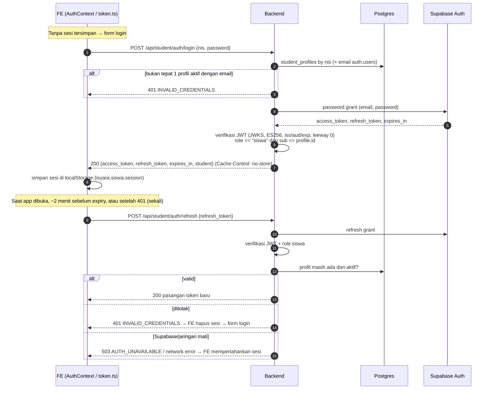
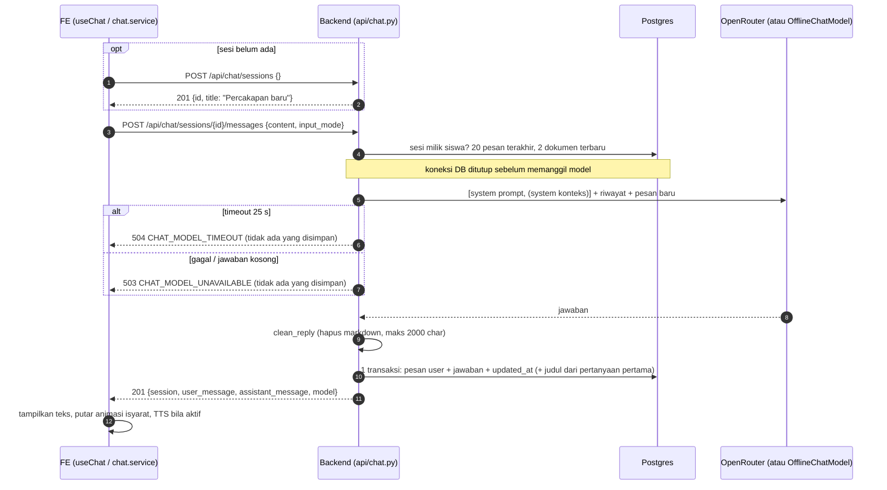
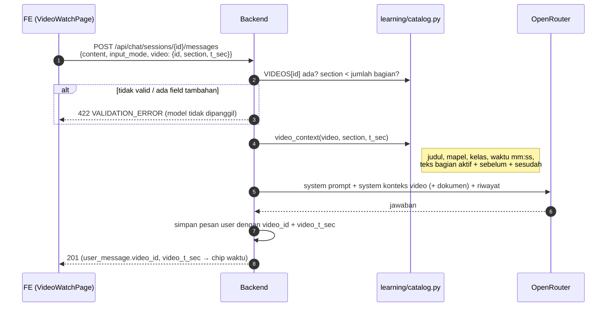
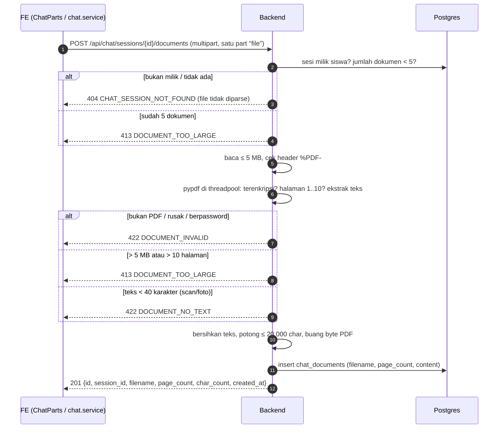
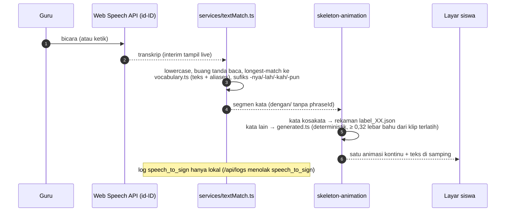
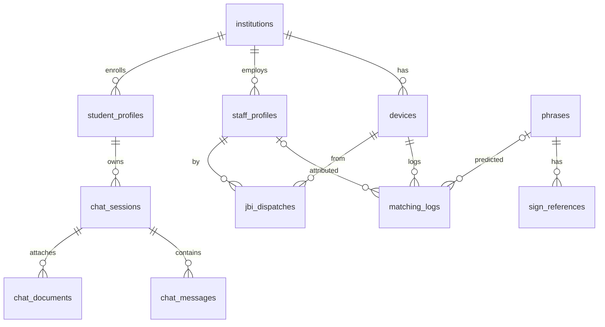
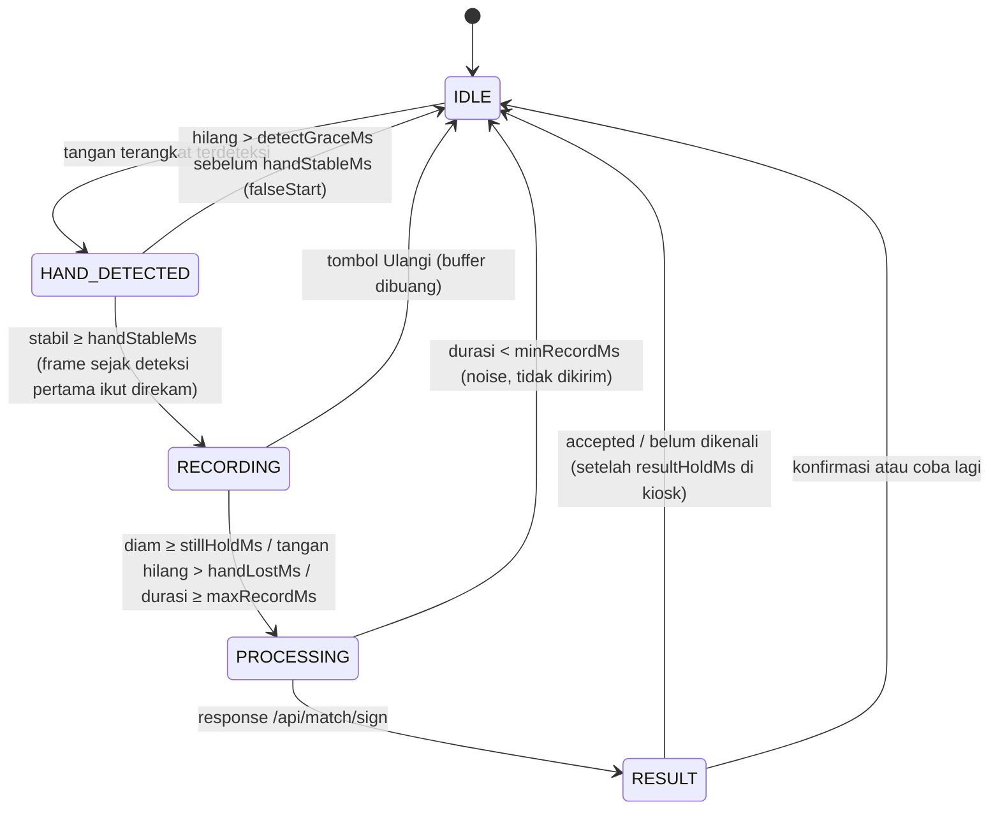

# System Design: ISYARA

Dokumen ini menjelaskan *perilaku* sistem: tanggung jawab komponen, alur, kontrak API, error, data, prompt model, auto-capture, batas Modeling, timeout, dan privasi. Kebutuhan produk ada di [PRD.md](PRD.md); struktur repo, stack, env, dan cara menjalankan ada di [ARCHITECTURE.md](ARCHITECTURE.md). Keputusan yang mengikat ada di [decisions.md](decisions.md).

Semua kontrak di sini diturunkan dari code (`backend/app/api/*.py`, `backend/app/main.py`, `backend/app/errors.py`, `Database/migrations/*.sql`). Daftar rute dijaga oleh `backend/tests/test_auth_admin.py::test_exact_production_route_surface`.

---

## 1. Ruang Lingkup

| Termasuk | Tidak termasuk |
|---|---|
| Aplikasi siswa (`Frontend/main`), Backend FastAPI, Modeling sebagai library, Supabase (Postgres, Auth, Storage), OpenRouter | UI admin/staf (hanya API), `/api/match/text` (belum ada), landing page (statis, tidak memanggil API) |

## 2. Tanggung Jawab Komponen

| Komponen | Bertanggung jawab atas | Tidak boleh |
|---|---|---|
| **FE aplikasi siswa** | UI chat, video, materi, profil; kamera + MediaPipe di browser; state machine auto-capture; Web Speech API (STT/TTS); animasi isyarat; penyimpanan sesi & preferensi di localStorage; refresh token | Memanggil Modeling atau OpenRouter langsung; menentukan keputusan confidence final; mengirim teks transkrip/PDF sebagai konteks; menyimpan landmark/video |
| **Backend** | Validasi request, kontrak response, error terstruktur, decision logic confidence, orkestrasi Modeling (timeout 3 s), akses DB/Storage, autentikasi (JWT Supabase), proxy login, konteks prompt chat (katalog video + teks PDF), ekstraksi teks PDF, panggilan OpenRouter | DTW, embedding, normalisasi landmark, preprocessing model, prediksi mandiri; log body request |
| **Modeling (`ml/`, `bisindo.predict.Predictor`)** | Preprocessing landmark, inferensi ONNX, kalibrasi, `phraseId` + `confidence` (+ `action` advisory) | Menentukan product action |
| **Supabase Auth** | Akun siswa/staf, password grant, refresh grant, JWKS (ES256) | Menjadi sumber role selain `app_metadata.role` |
| **Supabase Postgres** | Data domain, riwayat chat, dokumen teks | Diakses lewat Data API (RLS tanpa policy pada tabel sensitif) |
| **Supabase Storage** | Video referensi tanda (bucket private `sign-references`) | Bucket publik |
| **OpenRouter** | Jawaban chatbot dari teks | Menerima landmark, audio, video, atau API key dari FE |

## 3. Alur End-to-End

### 3.1 Login dan refresh sesi siswa



Idle > 14 hari menghapus sesi di FE. Beberapa panggilan bersamaan hanya memicu satu refresh.

### 3.2 Mengirim pesan chat



### 3.3 Tanya dari video

FE hanya mengirim referensi; transkrip dipilih Backend dari `backend/app/learning/catalog.py`.



ID sesi chat per video disimpan FE di `isyara.materi.<studentId>` sehingga tiap video punya percakapan sendiri.

### 3.4 Unggah PDF



### 3.5 Isyarat → teks (`/api/match/sign`)

Dipakai oleh "Pakai isyarat" di chat dan panel siswa di kiosk.

```mermaid
sequenceDiagram
    autonumber
    participant CAM as Kamera + MediaPipe (browser)
    participant AC as autoCapture.ts
    participant FE as FE (SignCapture / useSignFlow)
    participant BE as Backend (api/sign.py)
    participant MD as Modeling (Predictor)
    participant DB as Postgres
    CAM->>AC: frame landmark (hands 0–2, pose) per frame
    AC->>AC: IDLE → HAND_DETECTED → RECORDING → stop (lihat §9)
    AC-->>FE: event stop {frames, durationMs} (atau noise/falseStart → IDLE)
    FE->>BE: POST /api/match/sign {device_id, sequence, duration_ms}
    BE->>BE: validasi skema, duration_ms ≥ 500
    BE->>DB: device ada dan aktif?
    BE->>BE: jumlah frame ≤ max_frames Predictor (lebih → 413)
    BE->>MD: predict_json(sequence) (timeout 3 s, worker thread tunggal)
    MD-->>BE: {phraseId, label, confidence, action, reason, topK}
    BE->>BE: decide_sign_result (§6), lookup phrases.model_phrase_id
    BE->>DB: log accepted / escalated_to_jbi (best-effort)
    BE-->>FE: 200 {phrase_id, phrase_text, confidence, action}
    alt accepted
        FE->>FE: chat: kata ke kolom pesan / kiosk: teks + TTS
    else pending_confirmation
        FE->>FE: kartu konfirmasi; kiosk mengirim POST /api/logs confirmed
    else escalated_to_jbi
        FE->>FE: "Isyarat belum dikenali" + coba lagi / ketik
    end
    Note over CAM,FE: buffer frame dibuang setelah request
```

### 3.6 Kiosk: suara/teks guru → isyarat

Tidak memanggil Backend (ADR-050; `/api/match/text` diblokir sampai Modeling menyediakan `matchText`).



Aturan arbitrase kiosk (`state/KioskContext.tsx`): saat TTS berbunyi, STT nonaktif sampai selesai + 300 ms; saat siswa `RECORDING`, tombol Bicara nonaktif dengan alasan tertulis; saat guru bicara atau animasi diputar, auto-capture di-pause.

## 4. Kontrak REST API

### 4.1 Konvensi

- Base path `/api`. Docs/OpenAPI dimatikan (`docs_url=None`, `openapi_url=None`).
- JSON kecuali dua endpoint upload (multipart, tepat satu part `file`, tanpa field lain).
- Body dengan `extra="forbid"` menolak field tak dikenal (422). Berlaku untuk login, chat, admin, staf.
- Error envelope seragam: `{"error": {"code": "<KODE>", "message": "<teks>"}}`. Pesan validasi hanya berisi lokasi field + pesan, tidak pernah nilai input.
- Pagination (ADR-040): query `page` (default 1) dan `page_size` (default 50, maks 100, tidak di-clamp); response `{items, page, page_size, total}`.
- Auth: header `Authorization: Bearer <JWT Supabase>`. 401 menyertakan `WWW-Authenticate: Bearer`.
- CORS: origin dari `CORS_ALLOW_ORIGINS`; method GET, POST, PATCH, DELETE, OPTIONS; header Authorization, Content-Type; tanpa credentials.

| Dependensi auth | Syarat | Error |
|---|---|---|
| Publik | tidak ada | |
| `require_student` | JWT valid, `app_metadata.role == "siswa"`, `student_profiles` ada dan aktif | 401 UNAUTHORIZED (token), 403 FORBIDDEN (role/profil), 503 AUTH_UNAVAILABLE (JWKS) |
| `require_staff` | JWT valid, role `admin` atau `petugas`, `staff_profiles` aktif; data dibatasi institusi pemanggil | sama |
| `require_admin` | JWT valid, role `admin` (semua `/api/admin/*`) | sama |
| `require_institution_admin` | `require_admin` + profil staf admin aktif (endpoint staf admin) | sama |

Token siswa ditolak oleh dependensi staf/admin dan sebaliknya.

### 4.2 Publik

| Method | Path | Request | Response | Error |
|---|---|---|---|---|
| POST | `/api/match/sign` | `{device_id: UUID, sequence: SignSequence, duration_ms: int ≥ 500}` | 200 `{phrase_id: UUID\|null, phrase_text: str\|null, confidence: float, action: "accepted"\|"pending_confirmation"\|"escalated_to_jbi"}` | 422 VALIDATION_ERROR, 404 DEVICE_NOT_FOUND, 403 DEVICE_INACTIVE, 413 PAYLOAD_TOO_LARGE, 503 MODELING_UNAVAILABLE, 504 MODELING_TIMEOUT, 500 MODEL_MAPPING_ERROR / INTERNAL_ERROR |
| POST | `/api/logs` | `{device_id, direction: "sign_to_text", predicted_phrase_id: UUID\|null, confidence: float 0–1, resulted_action: "confirmed"\|"escalated_to_jbi"}`; `confirmed` wajib punya `predicted_phrase_id`; `speech_to_sign` ditolak | 204 | 422, 404 DEVICE_NOT_FOUND, 403 DEVICE_INACTIVE, 404 PHRASE_NOT_FOUND |
| GET | `/api/phrases` | | 200 `[{id, phrase_text, category}]` (hanya `active = true`) | 500 INTERNAL_ERROR |
| GET | `/api/health` | | 200 `{status: "ok", modeling: "loaded"\|"unavailable", max_frames, database: "postgres"\|"local-memory"}` | |
| POST | `/api/devices/{device_id}/heartbeat` | path UUID | 204 (set `last_heartbeat_at = now()`) | 422, 404 DEVICE_NOT_FOUND, 403 DEVICE_INACTIVE |

**`SignSequence`** (`backend/app/modeling/sequence.py`, cermin `ml/src/bisindo/schema.py`): `{frames: Frame[], mirrored: bool, width: int > 0, height: int > 0}`. `Frame = {t_ms: float, hands: Hand[] (0–2, kirim [] bila kosong), pose: [33][3|4] | null}` (key `pose` wajib). `Hand = {landmarks: [21][3], handedness: "Left"|"Right", score: float}`. `t_ms` tidak boleh turun. Semua key wajib walau Modeling punya default.

### 4.3 Siswa

| Method | Path | Auth | Request | Response | Error |
|---|---|---|---|---|---|
| POST | `/api/student/auth/login` | publik | `{nis: str 1–30, password: str 1–1024}` | 200 `{access_token, token_type: "bearer", expires_in, refresh_token, student}` | 422, 401 INVALID_CREDENTIALS, 503 AUTH_UNAVAILABLE |
| POST | `/api/student/auth/refresh` | publik | `{refresh_token: str 1–4096}` | 200 sama dengan login | 422, 401 INVALID_CREDENTIALS, 503 AUTH_UNAVAILABLE |
| GET | `/api/student/me` | siswa | | 200 `student` | 401, 403, 503 |

`student = {id, nis, full_name, class_name, grade, avatar_url, institution: {id, name}}`. Semua response di atas memakai `Cache-Control: no-store`. Setiap kegagalan kredensial memakai satu pesan generik.

### 4.4 Chat (semua `require_student`)

| Method | Path | Request | Response | Error khusus |
|---|---|---|---|---|
| GET | `/api/chat/sessions` | `page`, `page_size` | 200 `Page[Session]`, terbaru dulu | |
| POST | `/api/chat/sessions` | `{title?: str ≤ 120}` atau kosong | 201 `Session` (default "Percakapan baru") | 422 |
| PATCH | `/api/chat/sessions/{id}` | `{title: str 1–120}` | 200 `Session` | 404 CHAT_SESSION_NOT_FOUND, 422 |
| DELETE | `/api/chat/sessions/{id}` | | 204 (pesan + dokumen ikut terhapus) | 404 |
| GET | `/api/chat/sessions/{id}/messages` | | 200 `{session, items: Message[] (≤ 200 terakhir, lama → baru), documents: Document[]}` | 404 |
| POST | `/api/chat/sessions/{id}/messages` | `{content: str 1–1000, input_mode: "text"\|"sign" = "text", video?: {id: str 1–60, section: int ≥ 0, t_sec: int 0–36000}}` | 201 `{session, user_message, assistant_message, model: "openrouter"\|"offline"}` | 404, 422 (termasuk video/section tak dikenal), 503 CHAT_MODEL_UNAVAILABLE, 504 CHAT_MODEL_TIMEOUT |
| POST | `/api/chat/sessions/{id}/documents` | multipart `file` (PDF teks) | 201 `Document` | 404, 413 DOCUMENT_TOO_LARGE, 422 DOCUMENT_INVALID, 422 DOCUMENT_NO_TEXT |
| GET | `/api/chat/documents` | | 200 `{items: (Document + session_title)[]}` (≤ 100, terbaru dulu) | |
| GET | `/api/chat/activity` | | 200 `{days: 7, video_questions, documents}` | |

- `Session = {id, title, created_at, updated_at}`.
- `Message = {id, role: "user"|"assistant", content, input_mode: "text"|"sign"|null, created_at, video_id: str|null, video_t_sec: int|null}`.
- `Document = {id, session_id, filename, page_count, char_count, created_at}`.
- Judul sesi diambil dari pertanyaan pertama (maks 60 char pada batas kata) bila judulnya masih default; judul pilihan siswa tidak ditimpa.
- Sesi milik siswa lain dijawab persis seperti sesi yang tidak ada (404). `student_id` tidak pernah diterima dari request.
- `video_questions` menghitung pesan user dengan `video_id` dalam 7 hari; chat biasa tidak dihitung.

### 4.5 Staf dan operasional kiosk (tanpa konsumen FE sejak ADR-051)

| Method | Path | Auth | Request | Response | Error khusus |
|---|---|---|---|---|---|
| POST | `/api/auth/login` | publik | `{identifier: email\|NIP\|username (1–320), password}` | 200 `{access_token, token_type, expires_in, refresh_token, user: {id, full_name, role, nip}}` | 401 INVALID_CREDENTIALS, 503 AUTH_UNAVAILABLE |
| GET | `/api/me` | staf | | 200 `{id, full_name, role, job_title, nip, unit_kerja, shift_schedule, avatar_url, institution}` | |
| GET | `/api/devices/{device_id}/status` | staf | | 200 `{device_id, status: "online"\|"offline", last_heartbeat_at}` (online bila heartbeat < 90 s) | 404 DEVICE_NOT_FOUND (juga device institusi lain) |
| POST | `/api/kiosk/call-jbi` | staf | `{device_id, notes?: str ≤ 500}` | 201 `{id, institution_id, device_id, staff_id, notes, status, created_at}` + baris `matching_logs` `escalated_to_jbi` (1 transaksi) | 404, 403 DEVICE_INACTIVE |
| GET | `/api/kiosk/queue/current` | staf | `?device_id` | 200 `{device_id, queue_number, patient_identifier, category: "Pengunjung Baru"}` (token demo deterministik, tidak disimpan) | 404 |
| GET | `/api/staff/logs` | staf | `page`, `page_size`, `device_id?`, `resulted_action?` | 200 `Page[{id, device_id, direction, predicted_phrase_id, confidence, resulted_action, staff_id, created_at}]` | |

### 4.6 Admin (semua `require_admin`, tanpa DELETE)

| Method | Path | Request | Response | Error khusus |
|---|---|---|---|---|
| GET | `/api/admin/phrases` | `page`, `page_size` | 200 `Page[Phrase]` (termasuk nonaktif) | |
| POST | `/api/admin/phrases` | `{phrase_text, category: "Pendaftaran"\|"Keluhan"\|"Obat"\|"Administrasi"\|"Fallback", active?: bool}` | 201 `Phrase` | 409 CONFLICT |
| PATCH | `/api/admin/phrases/{phrase_id}` | minimal satu dari `phrase_text`, `category`, `active` (tidak boleh null) | 200 `Phrase` | 404 PHRASE_NOT_FOUND, 409 |
| POST | `/api/admin/phrases/{phrase_id}/references` | multipart `file`, `video/mp4` atau `video/webm` (signature dicek), ≤ 50 MB | 201 `{id, phrase_id, video_url (object path), approved, signed_url, signed_url_expires_in}` | 422, 404, 409 (sudah ada reference approved), 503 STORAGE_ERROR |
| GET | `/api/admin/logs` | `page`, `page_size`, `device_id?`, `predicted_phrase_id?`, `resulted_action?`, `direction?`, `created_from?`, `created_to?` (inklusif, ber-timezone) | 200 `Page[{id, device_id, direction, predicted_phrase_id, confidence, resulted_action, created_at}]` | 422 |
| GET | `/api/admin/devices` | `page`, `page_size` | 200 `Page[{id, institution_id, label, active}]` | |
| POST | `/api/admin/staff` | `{email, password ≥ 8, full_name, nip?, username?, role: "admin"\|"petugas", unit_kerja, job_title, shift_schedule?}` | 201 `Staff` (institusi dari profil pemanggil) | 409, 503 AUTH_UNAVAILABLE |
| GET | `/api/admin/staff` | `page`, `page_size` | 200 `Page[Staff]` (institusi pemanggil saja) | |

`Phrase = {id, phrase_text, category, language_variant, active, model_phrase_id, sign_recognizable}`. `Staff = {id, institution_id, full_name, role, nip, username, unit_kerja, job_title, shift_schedule, active, created_at}`.

## 5. Kode Error

Sumber: `backend/app/errors.py`. Kegagalan tak terduga (termasuk database) → 500 `INTERNAL_ERROR` dengan pesan generik; kode `DATABASE_ERROR` dari AGENTS.md tidak diimplementasikan secara terpisah.

| Kode | HTTP | Kapan | Respons FE yang diharapkan |
|---|---|---|---|
| VALIDATION_ERROR | 422 | Body/query/path tidak valid, field tambahan, video/section tak dikenal, upload referensi tidak valid | Perbaiki input; jangan retry otomatis |
| DEVICE_NOT_FOUND | 404 | `device_id` tidak ada (atau milik institusi lain di endpoint staf) | Konfigurasi `VITE_DEVICE_ID` salah |
| DEVICE_INACTIVE | 403 | Device nonaktif | Fallback ketik |
| PHRASE_NOT_FOUND | 404 | `/api/logs` atau admin: phrase tidak ada | |
| PAYLOAD_TOO_LARGE | 413 | Frame melebihi `max_frames` Predictor | Rekam ulang lebih pendek |
| MODELING_TIMEOUT | 504 | Modeling > 3 s | Fallback ketik / coba lagi |
| MODELING_UNAVAILABLE | 503 | Predictor gagal dimuat | Fallback ketik |
| MODEL_MAPPING_ERROR | 500 | `phraseId` tidak punya `phrases` yang `sign_recognizable` | Bug data/seed |
| INTERNAL_ERROR | 500 | Error inferensi, pelanggaran kontrak Modeling, error tak terduga | Pesan umum |
| UNAUTHORIZED | 401 | Token hilang/rusak/kedaluwarsa | Refresh sekali, lalu login |
| FORBIDDEN | 403 | Role salah atau profil hilang/nonaktif | Akhiri sesi |
| CONFLICT | 409 | Duplikat phrase/NIP/username, reference approved sudah ada | |
| STORAGE_ERROR | 503 | Supabase Storage tidak tersedia/salah konfigurasi | |
| AUTH_UNAVAILABLE | 503 | JWKS/Supabase Auth tidak terjangkau atau konfigurasi hilang | Pertahankan sesi, coba lagi |
| INVALID_CREDENTIALS | 401 | Login/refresh gagal (satu pesan generik) | Form login |
| CHAT_SESSION_NOT_FOUND | 404 | Sesi tidak ada atau milik siswa lain | Kembali ke chat baru |
| CHAT_MODEL_UNAVAILABLE | 503 | OpenRouter gagal, non-200, jawaban kosong/rusak | Tombol kirim ulang |
| CHAT_MODEL_TIMEOUT | 504 | OpenRouter > `OPENROUTER_TIMEOUT_S` | Tombol kirim ulang |
| DOCUMENT_INVALID | 422 | Bukan PDF, rusak, berpassword, multipart salah, file kosong | Pesan spesifik |
| DOCUMENT_NO_TEXT | 422 | Teks < 40 karakter (scan/foto) | Pesan spesifik |
| DOCUMENT_TOO_LARGE | 413 | > 5 MB, > 10 halaman, atau sudah 5 dokumen | Pesan spesifik |

## 6. Confidence Decision Logic

Implementasi: `backend/app/matching/decision.py` dan `backend/app/matching/sign.py`. Threshold konstanta `ACCEPT_THRESHOLD = 0.85`, `CONFIRM_THRESHOLD = 0.60`; confidence dipakai apa adanya (4 desimal dari Modeling).

1. Modeling `action == "reject"` → `escalated_to_jbi`, tanpa phrase, tanpa lookup. `topK` tidak pernah dipakai untuk mengarang phrase.
2. Selain itu, keputusan Backend dari confidence mengalahkan `action` advisory Modeling: `≥ 0.85` → `accepted`, `≥ 0.60` → `pending_confirmation`, sisanya → `escalated_to_jbi` (tanpa lookup).
3. Lookup hanya lewat `phrases.model_phrase_id`: tidak ditemukan atau `sign_recognizable` tidak true → `MODEL_MAPPING_ERROR`; ditemukan tapi `active` tidak true → `escalated_to_jbi`, phrase null.
4. `confirmed` bukan hasil inferensi; hanya ada setelah konfirmasi pengguna lewat `POST /api/logs`.
5. Logging: `/api/match/sign` menulis `accepted` dan `escalated_to_jbi` secara best-effort (gagal log tidak mengubah response). `pending_confirmation` tidak pernah disimpan.

FE memetakan `pending_confirmation` → state `confirmed` (kartu konfirmasi) dan `escalated_to_jbi` → "Isyarat belum dikenali". `Frontend/main/src/config/confidence.config.ts` menyimpan salinan threshold yang hanya dipakai simulator mock di kiosk (`?dev=1`); keputusan nyata selalu dari Backend.

## 7. Skema Database

Sumber: `Database/migrations/*.sql` (urut waktu). Semua migration setelah fase 1 bersifat aditif/idempoten.

| Migration | Isi |
|---|---|
| `20260928000000_phase1_core_schema.sql` | `institutions`, `devices`, `phrases`, `sign_references`, `matching_logs` + indeks |
| `20260929000000_phase3_seed_sign_vocabulary.sql` | Seed kosakata awal |
| `20260929010000_phase4_matching_logs_confidence_precision.sql` | `matching_logs.confidence` → `numeric(5,4)` |
| `20260929020000_phase5b_one_approved_reference_per_phrase.sql` | Partial unique index: maks satu reference `approved = true` per phrase |
| `20260930000000_adr045_seed_32_label_vocabulary.sql` | Seed 32 label |
| `20261002000000_adr047_staff_dashboard_schema.sql` | `staff_profiles`, `jbi_dispatches`, `devices.last_heartbeat_at`, `matching_logs.staff_id` |
| `20261006000000_adr049_seed_43_label_vocabulary.sql` | Seed label 32–42 |
| `20261013000000_adr051_student_chat_schema.sql` | `student_profiles`, `chat_sessions`, `chat_messages` |
| `20261014000000_adr053_chat_video_context_documents.sql` | `chat_messages.video_id`, `chat_messages.video_t_sec`, `chat_documents` |



| Tabel | Kolom penting | Constraint / catatan |
|---|---|---|
| `institutions` | `id`, `name`, `address` | |
| `devices` | `id`, `institution_id` (NOT NULL), `label`, `active` default true, `last_heartbeat_at` | Status online dihitung saat baca (< 90 s), tidak ada kolom status |
| `phrases` | `id`, `phrase_text`, `category`, `language_variant` default `BISINDO-Jakarta`, `active`, `model_phrase_id` UNIQUE, `sign_recognizable` default false | Indeks `active`. `model_phrase_id` = `label_XX` |
| `sign_references` | `id`, `phrase_id` NOT NULL, `video_url` (object path), `landmark_data` jsonb (tidak diisi), `signer_id`, `approved` | Unique parsial `(phrase_id) where approved = true` |
| `matching_logs` | `id`, `device_id`, `direction` (`sign_to_text`\|`speech_to_sign`), `predicted_phrase_id` null, `confidence numeric(5,4)`, `resulted_action` (`accepted`\|`confirmed`\|`escalated_to_jbi`), `staff_id` null, `created_at` | Indeks `(device_id, created_at)`. Tanpa landmark/audio/video. `staff_id` ON DELETE RESTRICT |
| `staff_profiles` | `id` = `auth.users.id` (cascade), `institution_id`, `nip`/`username` UNIQUE, `full_name`, `role` (`admin`\|`petugas`), `unit_kerja`, `job_title`, `shift_schedule`, `avatar_url`, `active`, `created_at` | RLS aktif tanpa policy. Hapus = soft delete |
| `jbi_dispatches` | `id`, `institution_id`, `device_id`, `staff_id` (RESTRICT), `notes`, `status` (`requested`\|`accepted`\|`completed`\|`cancelled`), `created_at` | RLS aktif tanpa policy |
| `student_profiles` | `id` = `auth.users.id` (cascade), `institution_id`, `nis varchar(30)` UNIQUE global, `full_name`, `class_name`, `grade` 1–12, `avatar_url`, `active`, `created_at` | RLS aktif tanpa policy |
| `chat_sessions` | `id`, `student_id` (cascade), `title` 1–120 default "Percakapan baru", `created_at`, `updated_at` | Indeks `(student_id, updated_at desc)`. RLS |
| `chat_messages` | `id`, `session_id` (cascade), `role` (`user`\|`assistant`), `content` 1–8000, `input_mode` (`text`\|`sign`\|null), `video_id` text 1–60 null, `video_t_sec` 0–36000 null, `created_at` = `clock_timestamp()` | Indeks `(session_id, created_at)`. RLS |
| `chat_documents` | `id`, `session_id` (cascade), `filename` 1–120, `page_count` 1–10, `content` 1–20100, `created_at` | Indeks `(session_id, created_at)`. RLS. Byte PDF tidak disimpan |

`community_submissions` tidak dibuat (roadmap). Tidak ada tabel pasien. Backend memakai koneksi Postgres langsung (psycopg, tanpa ORM), sehingga RLS tanpa policy hanya menutup akses Supabase Data API.

## 8. Konstruksi Prompt Model Chat

Sumber: `backend/app/chat/model.py`, `backend/app/chat/documents.py`, `backend/app/learning/catalog.py`, `backend/app/api/chat.py`.

**Urutan `messages` ke `POST {OPENROUTER_BASE_URL}/chat/completions`:**

1. `system`: `SYSTEM_PROMPT` tetap. Isinya: ISYARA asisten belajar siswa Tuli; Bahasa Indonesia sederhana; kalimat pendek, maks ~4 kalimat / ~60 kata (karena diperagakan kata demi kata); tanpa markdown, tabel, daftar, emoji, simbol; minta penjelasan bila pertanyaan kurang jelas; fokus materi sekolah; tolak yang tidak pantas/berbahaya; jangan meminta data pribadi.
2. `system` kedua (hanya bila ada konteks): gabungan, dipisah baris kosong, dari
   - **konteks video** `video_context(video, section, t_sec)`: judul, mapel, kelas, waktu `mm:ss`, judul + teks bagian aktif, bagian sebelum dan sesudah (bila ada), instruksi menjawab berdasarkan video;
   - **konteks dokumen** `document_context(...)`: 2 dokumen terbaru sesi, total ≤ 12 000 karakter (dokumen terbaru mendapat jatah dulu), tiap dokumen dipagari `<<<` … `>>>`, dengan instruksi mengabaikan perintah di dalam materi dan jujur bila jawaban tidak ada di materi.
3. Riwayat: 20 pesan terakhir sesi (lama → baru), `user`/`assistant`.
4. Pesan `user` baru.

Parameter: `model = OPENROUTER_MODEL` (default `openrouter/auto`), `max_tokens = 400`, `temperature = 0.4`. Header `X-Title: ISYARA`, `HTTP-Referer` bila `OPENROUTER_SITE_URL` di-set. `Authorization` di-set per request.

**Key dan kegagalan:**

| Kondisi | Perilaku |
|---|---|
| Tidak ada key sama sekali | `OfflineChatModel`: jawaban tetap yang menyatakan belum tersambung ke model AI; `model = "offline"` |
| Key menjawab 401/402/403/429 | Request yang sama dicoba dengan key berikutnya (`OPENROUTER_API_KEY` lalu `OPENROUTER_API_KEYS`, urut, tanpa duplikat) |
| Timeout | `CHAT_MODEL_TIMEOUT`, tidak dicoba key lain |
| Error jaringan, 5xx, non-200 lain, JSON rusak, jawaban kosong | `CHAT_MODEL_UNAVAILABLE`, tidak dicoba key lain |
| Sukses | `clean_reply`: hapus `**`, `__`, backtick, heading, bullet; rapatkan baris kosong; potong ≤ 2000 karakter pada batas kata |

Key tidak pernah di-log, tidak masuk `repr`, tidak masuk pesan error.

## 9. Auto-Capture dan Aturan FE

### 9.1 State machine

Fungsi murni `stepCapture(state, frame | null, now)` di `features/sign-to-text/autoCapture.ts`; `PROCESSING` dan `RESULT_*` dikelola `useSignFlow` (kiosk) atau `SignCapture` (chat).



Timer diam di-reset setiap gerakan melewati ambang, sehingga jeda alami < `stillHoldMs` tidak memutus rekaman. Gerakan dihitung dari rata-rata beberapa frame terakhir, bukan satu frame.

### 9.2 Parameter (`config/capture.config.ts`, sama dengan `ml/config/default.yaml → capture:`)

| Parameter | Nilai | Fungsi |
|---|---|---|
| `handStableMs` | 250 ms | Debounce sebelum RECORDING |
| `detectGraceMs` | 150 ms | Toleransi flicker detector saat debounce |
| `minRecordMs` | 500 ms | Lebih pendek = noise, tidak dikirim (Backend juga menolak `duration_ms < 500`) |
| `maxRecordMs` | 8000 ms | Batas rekaman, tetap diproses |
| `stillHoldMs` | 1500 ms | Diam selama ini → selesai (kalibrasi 1000–2000) |
| `handLostMs` | 500 ms | Tangan hilang selama ini → selesai |
| `motionWindowFrames` | 10 | Jendela rata-rata gerakan |
| `motionThreshold` | 0,008 | Perpindahan landmark ternormalisasi per frame di bawah ini = diam |
| `minHandConfidence` | 0 | Tidak menyaring (skor yang tersedia adalah skor handedness) |
| `restMaskY` | 1,35 | Pergelangan > 1,35 × lebar bahu di bawah garis bahu = tangan istirahat, tidak memicu capture |

`motionThreshold` dan `stillHoldMs` wajib dikalibrasi di perangkat demo; overlay `?dev=1` di kiosk menampilkan state, motion, dan timer secara live.

### 9.3 Aturan capture MediaPipe (wajib, memengaruhi akurasi)

1. MediaPipe Tasks Vision `HandLandmarker` (`numHands: 2`, `runningMode: "VIDEO"`) + `PoseLandmarker` lite, memakai file `.task` yang sama dengan training (`ml/mp_models/`).
2. Deteksi dijalankan pada frame kamera **asli (tidak di-mirror)** dan dikirim `mirrored: false`; mirror hanya untuk preview CSS.
3. Selalu kirim pose (model menormalisasi dengan bahu) dan `width`/`height` asli kamera.
4. Sekuens dimulai dari frame pertama tangan terdeteksi, termasuk masa debounce (pre-roll).
5. Timestamp `detectForVideo` harus selalu naik; `t_ms` di payload relatif terhadap awal rekaman.
6. Frame tanpa tangan tetap dikirim dengan `hands: []`.

### 9.4 Indikator status

Semua status harus terlihat, bukan hanya terdengar: IDLE (ajakan mulai), HAND_DETECTED/RECORDING (bingkai merah berdenyut pelan ≥ 1,2 s per siklus, teks "Merekam…"), PROCESSING (spinner "Memproses…"), hasil. Region `aria-live="polite"` mengikuti status; `prefers-reduced-motion` mengganti gerak dengan perubahan statis tanpa menghilangkan indikator. Animasi tidak menahan hasil.

### 9.5 Tampilan hasil dan fallback FE

| Situasi | Chat ("Pakai isyarat") | Kiosk |
|---|---|---|
| `accepted` | Kata ditambahkan ke kolom pesan (belum dikirim) | Teks + TTS otomatis, kembali IDLE setelah 7 s |
| `pending_confirmation` | "Maksudmu ini? · NN%" + kata, "Ya, tambahkan" / "Ulangi" (tidak mengirim `/api/logs`) | Kartu konfirmasi; TTS baru setelah Konfirmasi; `POST /api/logs` `confirmed` (fire-and-forget) |
| `escalated_to_jbi` | "Isyarat belum dikenali", coba lagi / ketik | Sama; tidak ada tombol JBI |
| Error/timeout `/api/match/sign` (FE timeout 4 s) | "Server pengenal isyarat tidak terhubung", siswa mengetik | Sisi siswa beralih ke input manual, sisi guru tetap normal |
| Kamera ditolak / mati | Pesan + tetap bisa mengetik | Fallback ketik/pilih frasa per sisi, tombol aktifkan ulang |
| Mic / `SpeechRecognition` tidak tersedia | | Sisi guru beralih ke ketik |
| Backend chat tidak terjangkau | "Tidak bisa terhubung ke server"; pesan bisa dikirim ulang | |
| 401 di API chat | Refresh sekali lalu ulangi; gagal → login | |

Tidak ada data palsu atau mode demo saat Backend mati (ADR-053 D7).

## 10. Batas Modeling

Backend memperlakukan Modeling sebagai library terpisah (`backend/app/modeling/client.py`, `LibraryModelingClient` di atas `bisindo.predict.Predictor`). Predictor dimuat sekali saat startup; bila gagal, app tetap jalan dan `/api/match/sign` menjawab 503.

| Kontrak | Status | Bentuk |
|---|---|---|
| `matchSign(sequence)` | Aktif | Input `SignSequence` (§4.2). Output Modeling `{phraseId: str\|null, label, confidence 0–1 (4 desimal), action: "accept"\|"confirm"\|"reject", reason?, topK (≤ 3)}`. `phraseId` null tepat saat `reject`. Field `audio` dan `debug` diabaikan. |
| `matchText(utterance)` | Belum ada | Kontrak logis `→ {phrase_id, confidence}`; semantic matching milik Modeling (ADR-044). `/api/match/text` tidak dibuat sampai kontrak tersedia. |

Backend tidak melakukan normalisasi, preprocessing, DTW, atau embedding. `action` Modeling hanya advisory; keputusan produk ada di §6. Threshold internal artefak (`thresholds.json`, mis. `kiosk_accept`) tidak dipakai Backend.

## 11. Timeout dan Batas

| Item | Nilai | Lokasi |
|---|---|---|
| Panggilan Modeling | 3 s, satu worker thread (panggilan antre) | `modeling/client.py` |
| Target `/api/match/sign` | p95 < 2,5 s | AGENTS / ADR |
| `duration_ms` minimum | 500 | `api/sign.py` |
| Frame maksimum | `Predictor.max_frames` (dilaporkan di `/api/health`) | 413 bila lebih |
| Model chat | `OPENROUTER_TIMEOUT_S`, default 25 s | `chat/model.py` |
| Jawaban model | `max_tokens` 400, ≤ 2000 karakter setelah dibersihkan | `chat/model.py` |
| Pesan siswa | 1–1000 karakter | `api/chat.py` |
| Riwayat ke model | 20 pesan terakhir | `HISTORY_FOR_MODEL` |
| Pesan dikembalikan | 200 terakhir | `MAX_MESSAGES_RETURNED` |
| PDF | ≤ 5 MB, ≤ 10 halaman, ≤ 5 per sesi, ≥ 40 karakter teks | `chat/documents.py`, `api/chat.py` |
| Teks PDF disimpan | ≤ 20 000 karakter | `MAX_DOC_CHARS` |
| Konteks dokumen | 2 dokumen terbaru, ≤ 12 000 karakter | `DOCS_FOR_MODEL`, `document_context` |
| Judul sesi | otomatis ≤ 60 karakter; input ≤ 120 | `api/chat.py` |
| Upload referensi video | ≤ 50 MB, mp4/webm; signed URL 3600 s | `storage/supabase.py` |
| JWKS | cache 300 s, timeout 2 s, cooldown 30 s; leeway JWT 0 | `auth/jwt_verifier.py` |
| Status kiosk online | heartbeat < 90 s | `db/kiosk.py` |
| FE: request umum / match | 4 s | `config/app.config.ts` |
| FE: auth & chat ringan | 8 s | `auth.service.ts`, `chat.service.ts` |
| FE: kirim pesan / unggah PDF | 35 s / 30 s | `chat.service.ts` |
| FE: refresh token | ~2 menit sebelum expiry; idle sesi 14 hari | `auth/auth.config.ts` |
| FE: login gagal | 5 kali → kunci 30 s | `auth/auth.config.ts` |

## 12. Privasi

| Data | Perlakuan |
|---|---|
| Landmark, audio, video kamera siswa | Diproses di memori browser/Backend, dibuang setelah response. Tidak pernah ke DB, file, log, atau pihak ketiga. Buffer capture dikosongkan setiap selesai. |
| Body request | Tidak di-log secara global. Pesan error validasi tidak memuat nilai input. Exception inferensi tidak di-chain agar landmark tidak bocor lewat traceback. |
| Teks chat | Disimpan di `chat_messages` per siswa; dikirim ke OpenRouter (disetujui ADR-051 D4). |
| `input_mode = sign` | Hanya penanda asal teks; landmark tidak disimpan. |
| Posisi video | `video_id` + `video_t_sec` pada pesan user. |
| PDF | Byte dibaca di memori lalu dibuang; hanya teks bersih (≤ 20 000 char) disimpan di `chat_documents`; teks dikirim ke OpenRouter (ADR-053 D4). Log `pypdf` diredam ke level ERROR karena peringatannya bisa mengutip isi file. |
| `matching_logs` | Metadata saja: device, arah, phrase, confidence, aksi, waktu. |
| Token & password | Password tidak pernah disimpan atau di-log. Token disimpan FE di localStorage (rentan XSS: jangan menyisipkan HTML dari luar). Response auth `no-store`. |
| API key OpenRouter, service-role key | Hanya di environment Backend; tidak pernah ke FE, response, log, atau DB. |
| Isolasi data | Semua query chat dibatasi `student_id` pemanggil; endpoint staf dibatasi institusi pemanggil; RLS tanpa policy menutup Supabase Data API. |
| Retensi | Belum diputuskan (PRD.md §19). |
